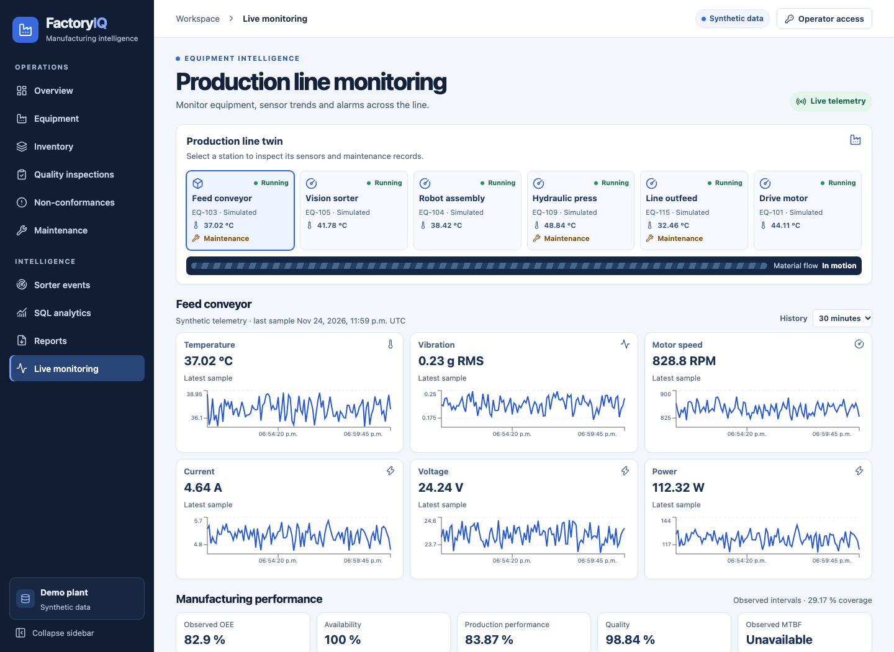
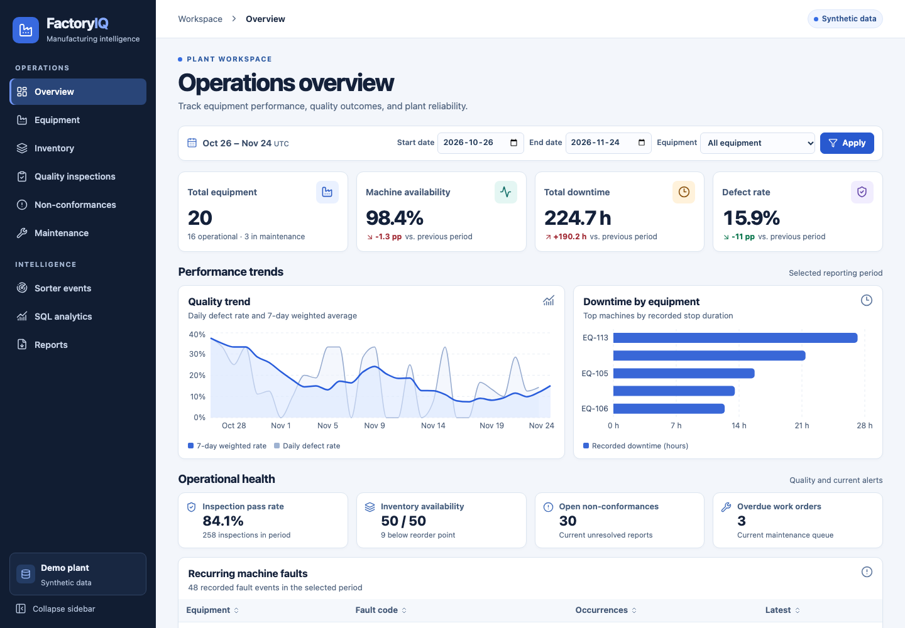
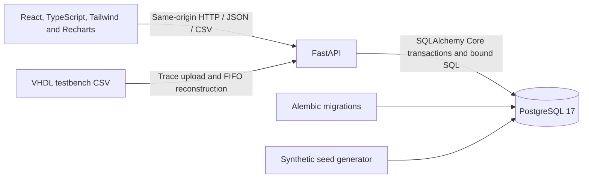

# FactoryIQ

**Manufacturing Intelligence & Quality Management System**

FactoryIQ is a portfolio application for a fictional manufacturing plant. It connects equipment status, stock control, inspection outcomes, corrective actions, maintenance, and sorter simulation telemetry in one PostgreSQL-backed workspace.

## V2 industrial IoT

V2 adds six simulated stations, scoped MQTT ingestion, live telemetry, a production-line digital twin, operator-controlled fault injection, an alarm lifecycle and explainable condition monitoring. SQL reports observed OEE, throughput, energy, downtime and repair metrics. The ESP32 bench firmware compiles for the documented board. Physical connection and calibration remain pending.



```sh
sh scripts/init-local-env.sh
docker compose --profile iot up --build --wait
```

Choose **Live monitoring** in the application. [V2 architecture and operation](docs/V2-IOT.md) · [Performance results](docs/V2-PERFORMANCE.md) · [ESP32 firmware and wiring](hardware/esp32/README.md) · [Fault screenshot](docs/screenshots/v2-fault-monitoring.png)

## V1 manufacturing workspace



[Recorded walkthrough](docs/media/factoryiq-demo.webm) · [Mobile dashboard](docs/screenshots/dashboard-mobile.png) · [Supplier quality screenshot](docs/screenshots/supplier-quality.png)

## Run the demo

Install Docker with Compose, open the repository root, and run:

```sh
sh scripts/init-local-env.sh
docker compose up --build --wait
```

Open [FactoryIQ](http://127.0.0.1:8000) or [the interactive API reference](http://127.0.0.1:8000/docs). Browse as a viewer, or use **Operator access** and enter the `FACTORYIQ_OPERATOR_TOKEN` from your local `.env` to exercise writes. The container applies migrations and seeds the fictional plant on first start. To stop it and preserve data, run `docker compose down`.

The recording shows the local read-only instance. Run the commands above for an interactive local instance.

The dataset has 20 machines, 10 suppliers, 50 part types, 1,000 inventory movements, 500 inspections, 50 work orders, 50 non-conformances and 5,000 sorter events. Seed generation fixes the random sequence. A new database can use `python -m factoryiq.seed --anchor YYYY-MM-DD` for fixed timestamps.

## Workflows

| Area | What to try |
| --- | --- |
| Overview | Filter by dates and machine. Compare availability, downtime and defect rate with the previous equal-length window. |
| Equipment | Search and edit equipment. Open a machine to view maintenance and calibration history. |
| Inventory | Receive, reserve, release, consume and quarantine units. Inspect the movement ledger and low-stock list. |
| Quality | Record readings against inclusive limits. Review the inspection and supplier defect rates. |
| Non-conformance | Investigate a report, assign corrective actions, complete them and close the report. |
| Maintenance | Schedule preventive or corrective work, review overdue work and record calibrations. |
| Sorter | Import [the synthetic trace](demo/synthetic-trace.csv) with a start time and equipment. Repeat with the same inputs and inspect import history. |
| Reports | Download equipment, inventory, inspection, downtime and maintenance CSVs. |

The sorter adapter was verified with the existing warehouse sorter’s trace format. The telemetry represents software simulation. All plant records bundled with FactoryIQ are synthetic.

## Architecture



[Entity relationship diagram](docs/DATABASE.md) · [SQL library](backend/factoryiq/sql/) · [API reference](docs/API.md) · [Measured query plans](docs/PERFORMANCE.md) · [Design decisions](DECISIONS.md)

Key PostgreSQL features include composite foreign keys, check constraints, partial indexes, row locks, transactions, savepoints, views, CTEs, window functions and multirange aggregation. Inventory updates serialize on the part row. CSV import writes events, downtime and success history in one transaction. Constraint failures roll back event writes before a failure record is committed.

## Verification and deployment

- **Pytest:** 16 passing cases against PostgreSQL, including the simultaneous last-unit race, stock rejection, import rollback, dashboard calculations and authorization.
- **Playwright:** Six passing Chromium workflows including mobile navigation, equipment, stock, inspection, maintenance, import, reporting and corrective actions.
- **EXPLAIN ANALYZE:** On 205,000 synthetic events, median execution was 0.045 ms with the partial fault index and 1.260 ms with the general time index for the measured machine-filtered query.
- **Dependency audit:** Python and npm checks reported zero known vulnerabilities in the scanned dependency sets.

[Verified GitHub Actions run](https://github.com/S4mos4/factoryiq-manufacturing-system/actions/runs/45510255118) · [Local development and hosting](docs/DEPLOYMENT.md) · [Security review](docs/security_best_practices_report.md) · [Interview guide](INTERVIEW_GUIDE.md) · [SQL practice](docs/SQL_PRACTICE.md) · [Project checkpoint](PROGRESS.md)

FactoryIQ is a single-plant portfolio system. It uses a shared demo operator identity, part-level inventory without lot genealogy, and calendar-time availability without shift calendars. The default data volumes suit a demonstration. The sorter analytics depend on recorded trace timing and observed repairs. Public deployment, access policies and production capacity need separate verification.

## AI assistance

The project brief, intended workflows and portfolio goals came from the project owner. Codex authored the implementation, schema, SQL, tests, firmware, documentation and project media and ran the software verification reported here. The interview guide identifies code for the owner to review, reproduce and modify before claiming personal implementation or verification.
