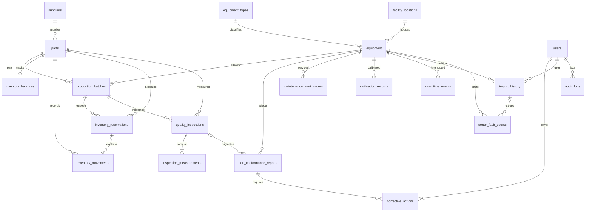

# Database design

PostgreSQL 17 · [Foundation DDL](../backend/migrations/versions/001_foundation.sql) · [Alembic revisions](../backend/migrations/versions/)

- Catalog tables normalize facilities, machine types, users, suppliers and parts.
- Composite foreign keys tie reservation and inspection part IDs to the selected batch’s part. Measurement rows have one characteristic per inspection and a database-generated inclusive pass flag.
- `inventory_balances` stores three quantities. `usable - reserved` is available to promise. Qualifying writes lock the part, update the balance, append a ledger movement and create an audit row in one transaction.
- `inventory_availability` exposes balances, supplier and reorder alerts. `maintenance_queue` derives overdue status from due date and completion state.
- Unique reservation request keys and partial unique movement indexes prevent duplicate reserve or close entries. An active reservation can close once by consumption or release.
- Sorter events use a unique machine/event key. Imports have a unique successful run per machine, file checksum and anchor. Failed and duplicate attempts appear in history.
- Audit entity references are typed by the `entity` label and stored with an ID so one audit stream can represent different relations. `demo_seed` is a standalone initialization marker.
