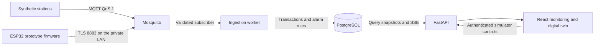

# FactoryIQ V2 industrial telemetry

## Run locally

```sh
sh scripts/init-local-env.sh
docker compose --profile iot up --build --wait
```

Open [FactoryIQ](http://127.0.0.1:8000), choose **Live monitoring**, and select a station. With operator access, open **Simulate fault**, trigger one of the scenarios, acknowledge its alarm, and restore normal operation. Compose without the IoT profile preserves the V1 startup path. The IoT profile provides six synthetic stations.

| Station | Equipment model |
| --- | --- |
| Feed conveyor | Belt speed, load, jam and motion state |
| Vision sorter | Sorting cadence and rejection counts |
| Robot assembly | Assembly load and cycle time |
| Hydraulic press | Pressure-equipment proxy through speed, load and temperature |
| Line outfeed | Finished-unit point for line throughput and OEE |
| Drive motor | Standalone motor signals, without production counts |

Overheat, vibration, jams, current spikes, shutdown, sensor disconnection and communication loss are time-bounded software scenarios. Communication loss suppresses heartbeats. Sensor disconnection omits an individual measurement.

## End-to-end path



Publishers use `factoryiq/device/{id}/telemetry` and `factoryiq/device/{id}/heartbeat`. Both carry `schema_version: 1`, `device_id`, and UTC `observed_at`. Each telemetry message additionally carries `message_id` (UUID), `interval_seconds` (1–60), status, and available measurements. Count fields represent deltas in the interval ending at the timestamp. Power is average watts over that interval. Payloads over 4 KiB, malformed payloads, topic mismatches, retained history and overlapping windows are rejected. Unique device/time and device/UUID pairs reject duplicates.

The simulator publishes every three seconds. After 12 seconds without a qualifying heartbeat the device is offline. The worker records connectivity and emits one open connectivity alarm per outage. Device readings can arrive out of order and support historical analysis. A late reading does not change current state. Device clocks must be synchronized. Commands are persisted application controls for the software simulator only.

The browser uses a same-origin Server-Sent Events stream with existing read authorization. Snapshots change when current sensor and alarm values change. A lightweight heartbeat and bounded reconnect interval keep idle streams observable. Historical charts use indexed time buckets while current values use a per-device latest timestamp.

## Analytics definitions

The reporting window uses complete, nonoverlapping measured intervals. For example, only a sample beginning and ending within the window contributes to counts, energy and downtime. Time coverage tells how much of the selected wall-clock duration was observed. Do not aggregate counts from sequential stations, since a unit can be counted more than once. Use the outfeed for line-level throughput.

| Metric | Definition |
| --- | --- |
| Observed availability | Sum of run seconds divided by observed planned seconds with reported run state |
| Production performance | Ideal cycle seconds × output divided by run seconds, with complete production counts over reported runtime |
| Quality | Good units divided by units for which a quality count exists |
| Observed OEE | Availability × performance × quality, displayed as a percentage when planned status and quality inputs are complete for the observed sample set |
| MTBF | Observed run time divided by reported fault episode starts in the selected window. Interpret as an observed estimate |
| MTTR | Mean elapsed start-to-resolution time for machine fault episodes that started and resolved within the window |
| Energy | Sum of measured watts × interval seconds, divided by 3,600,000. Use only intervals where power was measured |
| Throughput | Recorded production divided by interval seconds with counts, scaled to units per hour |
| Downtime | Observed planned seconds minus reported run seconds |

Missing denominators and unavailable measurements show as unavailable. Performance can exceed 100% if the configured ideal cycle is too slow. The OEE model reports observed sample windows and requires an actual shift calendar before use as a scheduled-production KPI. A sensor-only ESP32 generally cannot supply OEE.

## Alarms and condition monitoring

Warning and critical bounds are configurable per device and metric. The API validates their order, restricts edits to operators and audits changes. Alarms open once per active code and device. Escalation, acknowledgement and recovery have timestamps. Threshold recovery requires two consecutive normal readings, and missing readings do not clear a threshold. Connectivity recovery comes from a fresh heartbeat. Alarm records link to the monitored equipment and to its earliest open maintenance order when available.

The condition query builds a preceding baseline of up to 30 valid samples per temperature, vibration and current channel. It reports mean, sample standard deviation, z-score and change per second. A statistical anomaly needs at least eight points, a 3.5-sigma deviation and a minimum absolute displacement. Rate-of-change checks skip long sample gaps. This is explainable anomaly detection. Validation for physical failure prediction is pending.

## Security and hosting

Default broker TCP ports are confined to the Compose network. Broker identities have per-device publishing ACLs. The bridge has read access to telemetry and heartbeats. The private hardware override requires a TLS certificate and a specific LAN bind address. Only enroll known devices; separate the prototype password and Wi-Fi secrets from source. The demo API omits prototype records in demo mode and write routes enforce operator and read-only settings. Public deployment should exclude ingestion workers and simulator controls, use synthetic-only data, and use PostgreSQL SELECT-only credentials on a private network.

Render remains an option when repository-scoped access or a public image can be used, and the broker/database network can be kept private. Its free PostgreSQL offering expires after 30 days. Public V2 media and portfolio edits are prepared for approval. [Render free tier](https://render.com/docs/free) · [Render private networking](https://render.com/docs/private-network)

The MQTT bridge is a single subscriber with bounded broker queues. Moving to sustained industrial loads requires broker persistence, network buffering tests, stream fan-out, retention and database partitions sized from measurements. See [V2 performance](V2-PERFORMANCE.md) and [ESP32 setup](../hardware/esp32/README.md).
