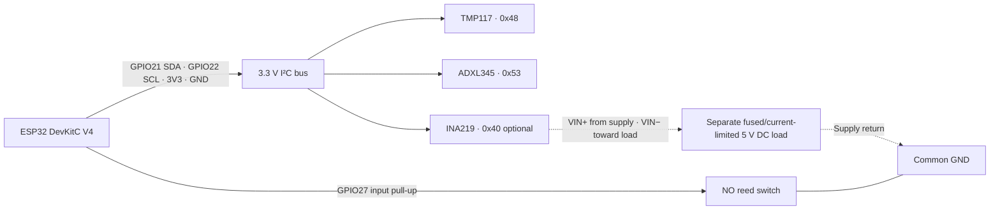

# ESP32 bench prototype

The firmware builds for the classic ESP32-WROOM-32 DevKitC V4. Pin assignments were checked against manufacturer documentation. Physical wiring, sensor accuracy, TLS connectivity on the board and calibration remain pending until the owner tests a real unit.

## Shopping list

| Quantity | Part | Required specification |
| --- | --- | --- |
| 1 | Espressif ESP32-DevKitC V4 or compatible classic ESP32-WROOM-32 dev board | USB data connector and accessible GPIO21, GPIO22 and GPIO27 headers. Use a USB data cable. |
| 1 | TMP117 breakout | 3.3 V logic and supply compatibility, I²C address 0x48. |
| 1 | ADXL345 breakout | 3.3 V logic and supply compatibility, I²C mode, address 0x53. |
| 1 | Normally open two-wire reed switch and a small magnet | Dry contact for a low-speed proximity/counting demonstration. |
| Optional | Adafruit INA219 breakout with R100 shunt | Address 0x40, 0.1 Ω shunt, 3.3 V breakout power and a separate current-limited 5 V DC test load. |
| 1 | Solderless breadboard and jumper leads | Short I²C leads and a common ground. |

## Wiring

Power the ESP32 over USB. Disconnect USB and the optional load supply before moving leads. Use 3.3 V I²C pull-ups. Check fitted breakout pull-ups before adding external ones. For bare ADXL345 hardware, hold CS high and SDO low for address 0x53. The TMP117 ADD0 selection is ground for 0x48. The reed switch is a dry contact between GPIO27 and ground with the firmware's internal pull-up. The optional INA219 measures a low-voltage DC load. It is not isolated.

| ESP32 pin | Connection |
| --- | --- |
| 3V3 and GND | Breakout 3.3 V power and common signal ground |
| GPIO21 | TMP117 SDA, ADXL345 SDA and optional INA219 SDA |
| GPIO22 | TMP117 SCL, ADXL345 SCL and optional INA219 SCL |
| GPIO27 | One reed contact. Connect the other contact to ground. |

Keep this prototype on isolated low-voltage bench supplies. For an optional load use a small current-limited 5 V DC circuit. Keep the load off the ESP32 3V3 pin. Connect INA219 VIN+ to the positive supply and VIN− toward the positive load terminal. Tie the supply negative, load return and signal ground together. Do not connect mains, a motor drive, or industrial wiring to this prototype.

[Espressif pin table](https://docs.espressif.com/projects/esp-dev-kits/en/latest/esp32/esp32-devkitc/user_guide.html) · [TI TMP117 data sheet](https://www.ti.com/lit/ds/symlink/tmp117.pdf) · [Analog Devices ADXL345 data sheet](https://www.analog.com/media/en/technical-documentation/data-sheets/adxl345.pdf) · [Adafruit INA219 breakout pinout](https://learn.adafruit.com/adafruit-ina219-current-sensor-breakout/pinouts)

## Build, register and flash

1. Install PlatformIO Core. From this directory copy `include/secrets.example.h` to `include/secrets.h`. Supply the lab Wi-Fi details, the broker hostname (matching its TLS certificate SAN), the CA certificate and the ESP32-only MQTT password. Keep secrets out of Git.
2. In the private Compose environment set `FACTORYIQ_DEMO_READS=false`. Set `FACTORYIQ_ESP32_DEVICE_ID` to match the firmware, generate `FACTORYIQ_ESP32_PASSWORD`, and set `FACTORYIQ_MQTT_LAN_IP` and `FACTORYIQ_MQTT_TLS_DIR`. Place `server.crt` and `server.key` in that directory. The broker runtime user needs read access to the key. Keep the CA private key offline. Allow TCP 8883 only from the bench subnet, with no port forwarding. The base listener has no host port.
3. From the repository root start `docker compose -f compose.yaml -f mqtt/compose.hardware.yaml --profile iot up -d --build`.
4. Register the device using `docker compose exec app python -m factoryiq.iot.register --device esp32-prototype --equipment EQ-101`. Choose an equipment code that represents the bench asset.
5. In this directory run `pio run`, then `pio run -t upload` when the board is connected. Inspect `pio device monitor` at 115200 and unlock the private UI using the local operator credential.

The broker scopes publishers to their ID. The firmware waits for NTP and validates the TLS certificate. QoS 1 publishes can be retried, and the database rejects duplicate messages. Individual sensors have independent validity. Missing readings are omitted. Firmware does not infer motor RPM, runtime or inspected quality from proximity pulses.

## Calibration and bench tests

1. Confirm bus rails are 3.3 V using a multimeter. Confirm I²C addresses 0x48 and 0x53 before adding any third module.
2. Compare stabilized TMP117 readings with a reference thermometer at two safe, stable temperatures. Record reference uncertainty and adjust `temperatureOffsetC` only after checking whether the offset is consistent.
3. Place the accelerometer on a rigid, stationary surface. Verify near-zero dynamic RMS after gravity removal. Check each axis against approximately ±1 g during a separate raw-sample bring-up test. Use a controlled vibration reference before setting machine thresholds.
4. Move the magnet through 20 controlled cycles. Check that the recorded pulse counts match and repeat at increasing speed to discover the debounce limit.
5. For INA219, compare voltage and current with a reference meter at two low-current loads and confirm shunt polarity and R100 marking.
6. Switch Wi-Fi off for more than 12 seconds, check the offline alarm, restore Wi-Fi, and verify the next heartbeat clears it. Unplug a sensor only with power removed, then reboot and check that missing values stay unavailable.

If the device stays offline, check SSID, NTP, TLS CA and hostname, bridge health, subscribed topics, ACL identity, and the device registration. For unstable sensors, shorten the bus, verify grounds and pull-ups, and separate sensor wires from noisy loads. Keep bench measurements and firmware version notes before reporting hardware validation.
